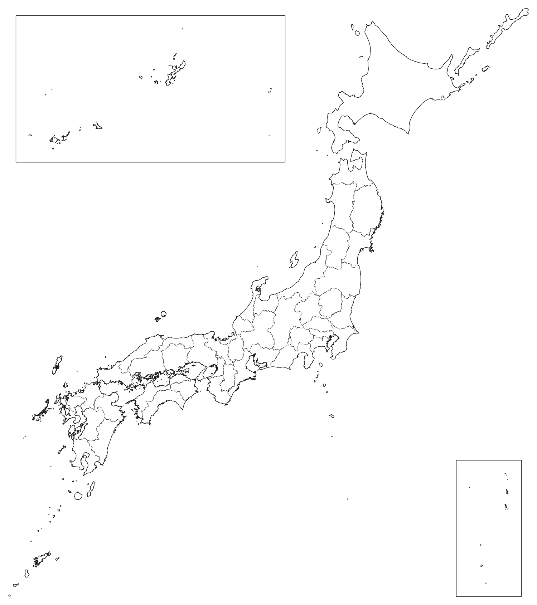
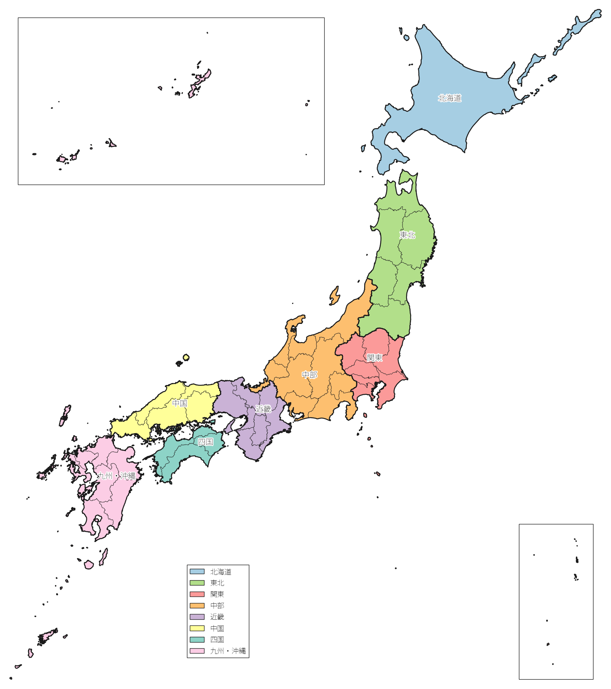
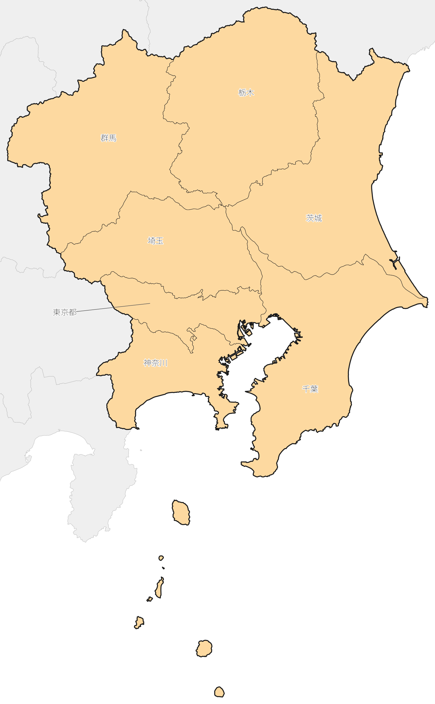

# japan-blank-map — 日本の白地図・地方区分図スキル

Claude 用の Agent Skill です。「日本の白地図を作って」「8地方区分で塗り分けて」「関東だけ切り出して県名を入れて」と頼むと、都道府県境つきの日本地図を PNG / SVG / PDF で作ります。

*An Agent Skill for Claude that draws blank maps of Japan with prefecture borders, regional-division maps, and cropped regional maps (PNG / SVG / PDF). Documentation is in Japanese.*

## 作例

| 白地図(既定) | 8地方区分の塗り分け | 関東の切り出し |
|:---:|:---:|:---:|
|  |  |  |

画像はこのスキルの描画スクリプトで生成したものです(縮小表示)。

## できること

- 全国の白地図(県境あり・文字なし)
- 地方区分での塗り分け: 8地方区分・7地方区分・気象庁の地方予報区・衆議院比例代表ブロック・三大都市圏・首都圏など14種のプリセットに加え、都道府県を自由にまとめた区分も描けます
- 特定の地方・県だけの切り出し(周辺の県を薄い灰色で添えることもできます)
- 地方名・県名・任意の文字(海域名・出典など)、凡例、地点の点
- 沖縄県と小笠原諸島は、本土と同じ縮尺の枠(インセット)に入れて配置
- SVG は県・地方ごとに `id` が付いているので、あとから色だけ変えることもできます

## 頼み方の例

- 「日本の白地図を PNG で作って」
- 「気象庁の地方予報区で塗り分けて、地方名を入れて」
- 「北信越の5県だけ色を付けて」
- 「九州を切り出して、県名を入れて」

## 導入方法

### claude.ai(Web・デスクトップアプリ)

1. [Releases](../../releases) から `japan-blank-map.zip` をダウンロードします。
2. claude.ai の設定にある「スキル」の項目から、ZIP をそのままアップロードします。
   コードの実行とファイル作成の機能を有効にしておく必要があります。

### Claude Code

```
/plugin marketplace add SHOYA-i/japan-blank-map
/plugin install japan-blank-map@japan-blank-map
```

手動で入れる場合は、`skills/japan-blank-map` フォルダを `~/.claude/skills/` にコピーします。

## 動作に必要なもの

- Python 3 と `shapely` `pyproj` `matplotlib` `numpy` `pillow`(無ければスキルが pip で入れようとします。手元の PC で使う場合は仮想環境の利用をおすすめします)
- インターネット接続: 実行時に地図データ(約 2.4 MB)を raw.githubusercontent.com から取得します
- 日本語の文字を入れる場合は日本語フォント(Noto Sans CJK JP、IPAexGothic など)

## 地図データの出典と、作った地図の利用条件

- 地図データ: 国土交通省「国土数値情報(行政区域データ)」を、スマートニュース メディア研究所が加工・公開している [japan-topography](https://github.com/smartnews-smri/japan-topography)(1%簡素化版)。このリポジトリには地図データを含めず、実行時に取得します。
- 作った地図を公開・配布するときは、国土数値情報の利用規約に従って出典を表示してください(表記例:「国土数値情報(行政区域データ)(国土交通省)を加工して作成」)。詳しくは[国土数値情報ダウンロードサイト](https://nlftp.mlit.go.jp/ksj/)の利用規約を確認してください。

## 注意

- 地方区分の構成は資料によって異なります(例: 近畿に三重を含めるか、北陸に新潟を含めるか)。スキルは、使った定義とその確度(公的な区分か、通称・一般的な区分か)を回答に書くように作ってあります。プリセットの出典は 2026-10-12 時点で確認したものなので、根拠として使う場合は出典で最新の内容を確認してください。
- 1% に簡素化したデータなので、拡大すると海岸線は粗くなります。市区町村の境界はありません。
- そのほかの仕様・制限は [SKILL.md](skills/japan-blank-map/SKILL.md) にまとめています。

## ライセンス

[MIT License](LICENSE)(スキル本体と描画スクリプト)。地図データはこのリポジトリに含まれず、各提供元の利用条件に従います。
